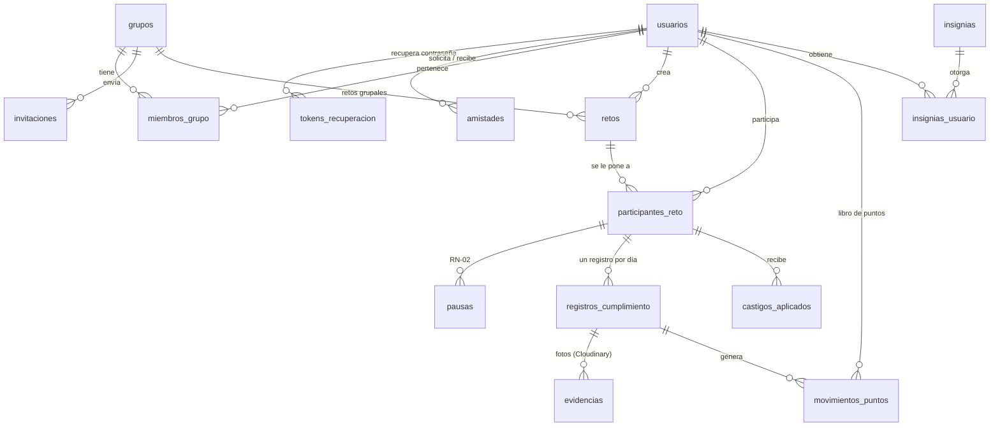

# Steply: base de datos y lógica de hábitos-reto

Paquete `@steply/database` (Integrante 3). Contiene:

- **Esquema PostgreSQL** con Prisma (`prisma/schema.prisma`) y su migración
  (`prisma/migrations/`), con restricciones de integridad, triggers e índices.
- **Lógica de negocio** lista para que el backend la llame: hábitos-reto,
  registro diario, puntos, rachas, castigos, evidencias, rankings e insignias.
- **Cierre automático** diario (incumplimientos, castigos y finalización de retos).
- **Datos de prueba** (`prisma/seed.js`) y **79 pruebas** unitarias y de integración.

> En Steply los hábitos se forman **por medio de retos**: no hay una tabla
> "hábitos" separada. Un reto es **PERSONAL** (solo su creador participa) o
> **GRUPAL** (pertenece a un grupo y el creador elige a quién se lo pone).

---

## 1. Puesta en marcha

Requisitos: Node 20 o superior y PostgreSQL 16 (o Docker).

```bash
# desde la raíz del repo: levanta PostgreSQL con las bases steply y steply_test
docker compose up -d

cd database
cp .env.example .env
cp .env.example .env.test      # y cambia la base a steply_test
npm install

npm run db:deploy              # aplica las migraciones
npm run db:seed                # insignias + datos demo (angie@ejemplo.com / Steply123!)
npm test                       # pruebas (usan .env.test)
npm run db:studio              # explorar los datos en el navegador
```

### Probar con el prototipo (sin backend ni frontend)

```bash
npm run prototipo      # abre http://localhost:3000
```

Es una página de prueba que usa directamente las funciones de este paquete.
Eliges el usuario en un menú (no hay contraseñas) y puedes:

- ver el dashboard, crear hábitos-reto con todas sus opciones y registrar "Sí / No lo completé" con foto;
- pausar, abandonar, editar o eliminar retos, y ver el ranking, el historial, los castigos y las evidencias;
- aprobar o rechazar evidencias, ver el calendario y el historial de puntos;
- **simular la fecha**: el botón **+1 día y cierre** avanza un día y ejecuta el cierre automático, para probar rachas, castigos y retos que terminan;
- reiniciar los datos demo cuando quieras.

Sin `CLOUDINARY_URL`, las fotos se reemplazan por una imagen de ejemplo. El
prototipo es solo para desarrollo y no reemplaza al backend real.

| Script | Qué hace |
|---|---|
| `db:migrate` | Crea una migración nueva después de cambiar `schema.prisma` (solo en desarrollo) |
| `db:deploy` | Aplica las migraciones pendientes (desarrollo, pruebas y producción) |
| `db:seed` | Carga el catálogo de insignias y, fuera de producción, los datos demo |
| `db:reset` | Borra la base de desarrollo y la vuelve a crear |
| `test` / `test:unit` / `test:integracion` | Pruebas |

En la nube sirve cualquier PostgreSQL gestionado (Neon, Supabase, Render o
Railway): basta con poner su `DATABASE_URL` y ejecutar `npm run db:deploy`.

---

## 2. Modelo de datos



| Tabla | Para qué | Requerimientos |
|---|---|---|
| `usuarios` | Cuenta, perfil, rol global (`USUARIO` / `ADMIN_GENERAL`), zona horaria y caché de puntos | RF-01, RF-03, RN-01, RNF-03 |
| `tokens_recuperacion` | Hash del token enviado por Gmail, con su expiración | RF-02 |
| `amistades` | Solicitudes pendientes, aceptadas o rechazadas (una fila por pareja) | RF-10, RF-11 |
| `grupos`, `miembros_grupo`, `invitaciones` | Grupos privados, roles `ADMIN` / `INTEGRANTE`, enlace e invitaciones | RF-12, RF-20, RN-03 |
| `retos` | Hábito-reto: frecuencia, fechas, puntos, toggles de evidencia y aprobación, castigo | RF-04, RF-05, RF-13, RF-16 |
| `participantes_reto` | A quién se le puso el reto, con caché de sus puntos, racha y resultado final | RF-13, RF-15, RF-19 |
| `pausas` | Pausas por causa mayor (sin traslapes) | RF-05, RN-02 |
| `registros_cumplimiento` | "Sí / No lo completé" por día, con fecha, hora y estado de revisión | RF-06, RF-07 |
| `evidencias` | URL y `public_id` de las fotos en Cloudinary | RF-14 |
| `movimientos_puntos` | Libro contable: cada suma o resta con su motivo | RF-16 |
| `castigos_aplicados` | Castigos que recibió cada participante (con o sin puntos) | RF-16 |
| `insignias`, `insignias_usuario` | Catálogo e insignias desbloqueadas | RF-16, RF-18 |

### Integridad garantizada por PostgreSQL

Aunque alguien escriba directo en la base, estas reglas no se pueden romper.
Están en la migración y tienen pruebas en `test/integracion/integridad.test.js`:

- El correo es único y está en minúsculas, con formato válido (RN-01).
- Solo hay una amistad por pareja, en cualquier dirección, y nadie es amigo de sí mismo.
- Un reto PERSONAL no tiene grupo y uno GRUPAL sí. La fecha de fin no es anterior a la de inicio (CU-07).
- La frecuencia es coherente con sus parámetros: `SEMANAL` lleva de 1 a 7 veces, `DIAS_ESPECIFICOS` lleva días del 1 al 7.
- Los puntos van de 0 a 10 000. Un castigo "al finalizar" exige fecha de fin. La aprobación solo existe en retos grupales.
- Los participantes de un reto grupal son miembros del grupo, y en uno personal solo participa su creador (RNF-04, por trigger).
- Un grupo nunca se queda sin admin. Si el último admin sale, se asciende al integrante más antiguo (trigger).
- Las pausas de un participante no se traslapan (`EXCLUDE` con `btree_gist`).
- Hay un registro por participante y día, y un "no cumplido" nunca queda pendiente de aprobación.
- Evidencias: solo `https`, formatos jpg/png/webp/heic y un máximo de 5 MB.
- Movimientos de puntos: el signo concuerda con el tipo (un castigo siempre resta).
- Borrar un reto o un grupo elimina en cascada todo su historial.

---

## 3. Reglas de negocio implementadas

**Frecuencia** (personalizable por el usuario): `DIARIA`, `SEMANAL` (X veces
por semana, de lunes a domingo) o `DIAS_ESPECIFICOS` (por ejemplo, lunes, miércoles y viernes;
1 = lunes … 7 = domingo).

**Registro diario (CU-05).** El participante marca "Sí, lo completé" o "No lo
completé". Solo se puede registrar dentro del tiempo establecido: el día de hoy
o hasta `diasGraciaRegistro` días atrás, que es configurable de 0 a 7. Además, el día
debe estar programado y el participante no puede estar en pausa ese día. Mientras
la ventana siga abierta se puede corregir el registro, y los puntos se
recalculan sin duplicarse. "Hoy" se calcula en la zona horaria del usuario.

**Puntos (definidos por quien crea el reto).**

- `puntosPorCumplimiento` se suma por cada día cumplido. En `SEMANAL` solo suman las primeras N veces de la semana.
- `puntosPorIncumplimiento` se resta por cada día incumplido, ya sea porque marcó "No" o porque el día cerró sin registro. En `SEMANAL` se resta al cerrar la semana, una vez por cada vez que faltó.
- Hay un bono opcional: cada `bonoRachaCada` unidades de racha se suman `bonoRachaPuntos`.
- Cada suma o resta queda en `movimientos_puntos`. `usuarios.puntos_totales` y `participantes_reto.puntos` son cachés que siempre se recalculan desde ese libro.

**Evidencias.** Con el toggle `requiereEvidencia`, cumplir exige al menos una
foto (máximo 5 por registro). Con el toggle `requiereAprobacion` (solo en retos
grupales), el cumplimiento queda `PENDIENTE` hasta que el creador del reto o un
admin del grupo lo aprueba. Nadie aprueba su propio registro. Un registro pendiente
no suma, uno aprobado suma y uno rechazado cuenta como incumplimiento.

**Rachas (RF-08).** En `DIARIA` y `DIAS_ESPECIFICOS` se cuentan los días programados
consecutivos. En `SEMANAL` se cuentan las semanas consecutivas que alcanzaron la meta.
Los días no programados y los días en pausa no rompen la racha (RN-02). Un día
abierto sin registro tampoco la rompe todavía, pero un "No lo completé" explícito
sí. Se guarda la racha actual y la mejor.

**Castigos (RF-16).** Se definen al crear el reto, con una descripción
(por ejemplo, "Invitar el café"), los puntos a restar y el periodo: `SEMANAL` o
`AL_FINALIZAR`. Se aplican a quien no alcance `porcentajeMinimoCumplimiento`
(100 % por defecto) de los días exigidos en ese periodo. Los registros pendientes
de aprobación cuentan a favor. El grupo puede marcar un castigo como saldado.

**Finalización.** Cuando cierra el último día del reto se calcula si cada
participante lo completó, se asignan las posiciones finales (los empates
comparten lugar) y se otorgan las insignias de "reto completado" y "reto ganado".

---

## 4. Integración con el backend (Integrante 2)

El backend autentica al usuario (bcrypt, sesión) y le pasa su `id` a los
servicios. Los servicios validan los permisos sobre el dato concreto y lanzan
`ErrorSteply` con `status` HTTP y `codigo`.

```js
// backend/src/app.js
import express from 'express';
import cron from 'node-cron';
import multer from 'multer';
import {
  prisma, retos, registros, evidencias, puntos, cierre,
  ErrorSteply, traducirErrorBD, crearAlmacenamientoCloudinary,
} from '@steply/database'; // "file:../database" en package.json

const app = express();
app.use(express.json());
const almacen = crearAlmacenamientoCloudinary();
const subida = multer({ storage: multer.memoryStorage(), limits: { fileSize: 5 * 1024 * 1024 } });

// Registro de usuario: el correo SIEMPRE en minúsculas y la contraseña con bcrypt.
//   await prisma.usuario.create({ data: { nombre, correo: correo.trim().toLowerCase(),
//                                         passwordHash: await bcrypt.hash(password, 10) } });

app.post('/api/retos', async (req, res, next) => {
  try { res.status(201).json(await retos.crearReto(req.usuario.id, req.body)); } catch (e) { next(e); }
});

app.post('/api/retos/:id/registros', subida.array('fotos', 5), async (req, res, next) => {
  try {
    const fotos = await Promise.all((req.files ?? []).map((f) => evidencias.subirEvidencia(f, { almacenamiento: almacen })));
    const r = await registros.registrarCumplimiento(req.usuario.id, req.params.id,
      { cumplido: req.body.cumplido === 'true', nota: req.body.nota, evidencias: fotos },
      { almacenamiento: almacen });
    res.status(201).json(r);
  } catch (e) { next(e); }
});

app.get('/api/retos/:id/ranking', async (req, res, next) => {
  try { res.json(await puntos.rankingReto(req.usuario.id, req.params.id)); } catch (e) { next(e); }
});

// Errores de dominio → respuesta HTTP
app.use((err, req, res, next) => {
  const e = traducirErrorBD(err);
  if (e instanceof ErrorSteply) return res.status(e.status).json({ codigo: e.codigo, mensaje: e.message, detalles: e.detalles });
  console.error(err);
  res.status(500).json({ codigo: 'ERROR_INTERNO', mensaje: 'Ocurrió un error inesperado' });
});

// Cierre automático: cada hora (es idempotente, así cubre todas las zonas horarias).
cron.schedule('5 * * * *', () => cierre.ejecutarCierreDiario().catch(console.error));
```

### Funciones disponibles

| Módulo | Funciones | Pantalla / CU |
|---|---|---|
| `retos` | `crearReto`, `obtenerReto`, `listarRetosUsuario`, `listarRetosGrupo`, `editarReto`, `eliminarReto`, `cancelarReto`, `agregarParticipantes`, `removerParticipante`, `abandonarReto`, `pausarParticipacion`, `reanudarParticipacion` | 05, 06, 07, 15 · CU-03, CU-04, CU-07 |
| `registros` | `registrarCumplimiento`, `revisarRegistro`, `listarPendientesRevision`, `historialCumplimiento`, `retosDelDia`, `calendarioMensual` | 04, 08, 09 · CU-05 |
| `evidencias` | `validarArchivo`, `subirEvidencia`, `agregarEvidencias`, `eliminarEvidencia`, `listarEvidenciasReto` | 07, 08 · CU-08 |
| `puntos` | `rankingReto`, `rankingGrupo`, `resumenUsuario`, `movimientosUsuario`, `castigosReto`, `saldarCastigo`, `ajustarPuntos`, `verificarCachesPuntos` | 04, 12, 13 |
| `insignias` | `listarInsignias`, `evaluarInsignias` | RF-18 |
| `cierre` | `ejecutarCierreDiario`, `finalizarReto` | tarea programada |

Las funciones están documentadas con JSDoc en `src/servicios/`. El primer
argumento siempre es el id del usuario que hace la acción.

**Evidencias directas desde el frontend (opcional).** `almacen.firmarSubida()`
genera una firma para que el navegador suba la foto directo a Cloudinary.
Después el frontend envía `{ url, publicId, formato, bytes }` y el backend los
pasa en `evidencias`. `normalizarEvidencia` verifica que la URL sea de la cuenta
y la carpeta de Steply.

**Fuera de este paquete.** El login, las sesiones, el envío de correos (Gmail),
la creación de grupos e invitaciones y la gestión de usuarios los programa el
backend (Integrante 2). Las tablas ya existen y están listas para eso.

---

## 5. Estructura

```
database/
├── prisma/
│   ├── schema.prisma          # modelos, relaciones e índices
│   ├── migrations/            # SQL (incluye CHECK, EXCLUDE y triggers)
│   └── seed.js                # insignias + datos demo
├── prototipo/                 # página de prueba (npm run prototipo)
├── src/
│   ├── index.js               # exporta todo
│   ├── cliente.js             # PrismaClient compartido
│   ├── errores.js             # ErrorSteply y traducción de errores de BD
│   ├── logica/                # reglas puras: frecuencia, puntos, rachas
│   ├── servicios/             # retos, registros, evidencias, puntos, cierre…
│   ├── almacenamiento/        # adaptador de Cloudinary (y uno en memoria)
│   └── utils/fechas.js
└── test/
    ├── unit/                  # lógica pura (sin BD)
    └── integracion/           # contra PostgreSQL (.env.test)
```

## 6. Para validar con el equipo

Estos son valores por defecto que se pueden cambiar sin rediseñar nada:

- Puntos por defecto: +10 al cumplir y 0 al incumplir. El creador del reto los cambia.
- Un reto no puede empezar en una fecha pasada. Así se evita penalizar días anteriores a su creación.
- Editar los puntos de un reto no cambia los puntos que ya se otorgaron; las rachas sí se recalculan.
- Eliminar un reto borra su historial y los puntos que generó (CU-04). `cancelarReto` lo detiene sin borrar nada.
